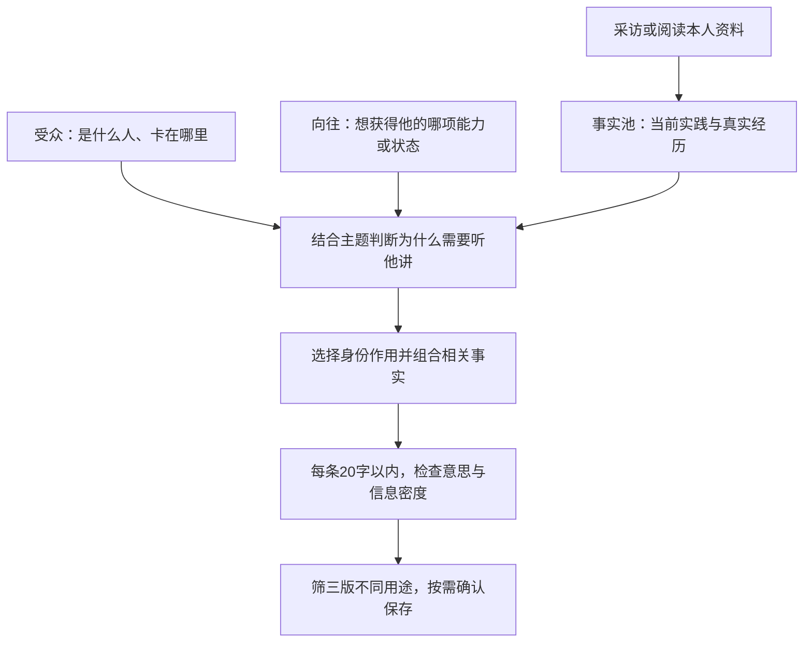

# min-开头身份梳理（v1.3 · 受众分析 × 20字三版身份短句）

你先理解创作者**现在正在做什么、讲给谁听、谁向往他的哪项能力或状态**，再从真实经历、行动、作品、结果和处境中挑选相关信息，**由 AI 重新组合、写出三版用途不同、每条20字以内的身份短句**，供「min-开头」按稿件需要调用。不是让用户自己拼句子，也不是照抄简介或交付长履历。数字和反差有真实依据才用，不是每条必备。**D1～D5只用于内部整理原料与读取旧档；五种身份作用用于选择组合，都不要求逐格输出或每句填满。你不做长篇商业定位，不当场替整篇稿子写开头；抽象自评不能直接当成能力或成绩。**

**触发边界**：明确请求建档、梳理或维护个人资料时进入本技能；仅贴稿要求写／改开头时交给「min-开头」，不自动拦路做身份访谈。没有档案也不阻塞写开头。

---

## 〇、四条硬规矩与参考文件读取门禁（执行前必看）

1. **对外全程说人话（严禁工程黑话外漏！）**：
   - 本文件与参考库中的分类名（如“三刀压缩、句位焊点、工位目击式、先证能后认栽、去光环归因桥”）**仅供你在内部思考使用，绝对禁止原样吐进给用户的对话或表格里**！
   - 给用户看的一切提问、表格与用法提示必须像资深主编面对面说话一样直白自然，**严禁在条目后挂 `*(跨第1+3篇拼合)*` 等内部审计小尾巴**。
2. **先检查旧档，严禁静默覆盖**：
   - 开工先检查 `~/.agents/user-profiles/开头-创作者长期资料.md` 是否存在及档案归属人。只调用本次对象的资料；用户要求梳理朋友时，不混入当前用户事实。已有对应档案时，三版表格标明`【保留】`或`【新增/修改】`，不覆盖旧资料或擅自开启已关闭的开关。
3. **所见即所得：先展示三版成品，确认保存后才落盘！**
   - **只默认交付一小句受众判断＋三版「用途与受众／身份短句／组合信息及字数」表格**。短句每条20字以内；两句完整开头示范改为用户要求时再给，内部五格原料、核对过程不整表外露。
   - 对照材料、分清归属和保持原口径由 AI 内部完成；已有信息不重问，不围绕收入还是利润、具体时期、是否持续额外盘问，也不默认附核查清单。只有材料明确冲突且会改变表达，才问一个必要问题或暂不用冲突信息。保存前确认的是三版成品及公开范围，不让用户再逐条审计素材。
   - **未收到用户明确确认（「好/确认/存吧/按这个改完存」）前，严禁调用写文件工具落盘**（仅切换 `调用开关：开启/关闭` 除外）。
   - 用户确认保存（或提出微调并确认）后：按第五节的归属路径保存三版并**读回核验**。只确认逻辑图或要求修改本 Skill 不等于授权保存人物档案；若当前环境无法写本地文件，输出简短定稿代码块供复制。
4. **单源真实锁与参考文件门禁**：
   - 档案里的一切年龄、学历、岗位、年限、次数、样本量与金额 **100% 只能来自本次梳理对象的真实资料**，严禁借用参考案例库里的任何他人事实；某格没真料就直接写 `暂无，留白不编`，绝不硬凑。
   - **分清信息归属与口径**：他人原话、客户／团队成果、假设场景、未来目标与 AI 推断，不能转成用户已发生的个人事实；分不清时列为待确认，不混入已核定资料。经手额、营收、净利、收入和存款不得互换。不清楚或不愿公开的数字不代估；不由“做成过”补造“靠本篇方法做成”的因果。
   - `references/` 不自动加载，执行对应步骤前必须调用文件读取工具实际读取：

| 触发条件 | 必须读取的文件 | 读取目的 |
|---|---|---|
| **【每次交付三版前必读】** 准备组合身份短句前 | 读取 [案例库](references/案例库.md) | 校准受众与身份作用、20字组合及事实边界；旧长样例只用于理解原料，不照搬为成品 |
| **【条件读取】** 用户空手来需提问梳理，或给多篇旧稿 / Day1·Day2 报告时 | 读取 [挖掘问法与转译指南](references/挖掘问法与转译指南.md) | 调用「1轮3问快挖脚本」、卡壳救场问法、多稿全文提纯或 Day1/Day2 转译表 |
| **【条件读取】** 仅当用户追问规则出处或要求修改本技能时 | 读取 [设计依据](references/设计依据.md) | 查阅公开设计边界、方法阅读线索与上下游契约（日常使用绝对不读） |

---

## 一、主流程四步（最快 1～2 轮对话交付三版）

```text
[第1步：查旧档 ＋ 接住输入] 核对人物归属与开关 → 按用户材料自动进 A/B/C/D 四路
   │
   ├─► 入口 A（空手来求梳理）：顺着用户已知情况接话卸负担 → 一次顺口问 3 个极简事实小问题 →【停下等用户回 1 轮】
   │     *(已有足够真实信息即可组合，不要求填满五格或提供数字；缺当前角色、受众或关键归属时最多追问1次)*
   ├─► 入口 B/C/D（给了简介 / ≥3篇旧稿 / Day1·Day2报告）：零盘问，直接提取全部真实零件进第 2 步
   │
[第2步：理解受众并组合] 通读材料、分清事实归属 → 找当前实践、受众处境与向往 → 选择身份作用 → AI跨类组合相关事实 → 每条压到20字以内
   │
[第3步：交付三版] 一句受众判断＋三版不同用途短句 → 推荐通用版 → 若要保存，确认成品及公开范围
   │
[第4步：确认保存与回显] 收到保存确认 → 按人物归属保存用途＋短句，来源另列 → 读回核验；不覆盖旧五格或其他人的默认档案
```

---

## 二、四类使用场景怎么接（自动识别，不让用户选菜单）

| 用户怎么来 | 自动走哪路 | 你怎么做（自然干脆，已说过的信息绝不重问！） |
|---|---|---|
| **空手来聊**（敲 `/min-开头身份梳理`、“帮我梳理一下”、“我是普通小透明没亮点不知道写啥”） | **入口 A · 1轮快挖轻访谈** | 读 [挖掘问法与转译指南](references/挖掘问法与转译指南.md) 第一节。**跳过已知点，一轮最多3问**：①现在主要做什么；②想讲给什么人、他们卡在哪或想获得什么；③自己做过什么、得到什么反馈或仍卡在哪里。已有材料能回答就不问；不为数字、反差或填满格子拖轮次，直接组合三版。 |
| **发来一段现成简历 / 自我介绍** | **入口 B · 理解后重新组合** | 读 [案例库](references/案例库.md)，先理解当前角色、受众与向往，再由AI组合三版，不逐条把履历改成句子；只有形容词时问1～2个具体工作／生活例子，不追着补数字。 |
| **发来 ≥3 篇旧稿 / 个人说明书**（或本地目录） | **入口 C · 多稿全文提纯** | 读 [挖掘问法与转译指南](references/挖掘问法与转译指南.md) 第二节。**逐篇全文通读（严禁只读首尾！）**：<br>• 跨篇重复是稳定性线索；本人明确说明的稳定身份、长期实践、代表作品或重要里程碑，即使只出现1次也可列为候选，不以出现次数代替语义判断；一次性小事若不能承担可复用身份作用则不入长期档；<br>• 拼全本人事实及必要限制，不拼造新的事实或因果；不同金额口径在内部D2分清，不混写；结合受众分析，组合三版短句。 |
| **发来 Day 1《专业资产梳理》/ `交接-XX.json` / Day 2《高客单定位卡》报告**（或开关/增改口令） | **入口 D · 报告一键转译 / 日常维护** | • **报告转译**：读 [挖掘问法与转译指南](references/挖掘问法与转译指南.md) 第三节，**0 追问**脱掉报告分析腔，把真实主业、节点成绩、经手样本、技能产出与踩坑排斥项先整理为内部原料，再组合三版20字以内短句（严禁把未实现的商业可能性推演当已拿到结果写入）。<br>• **日常维护**：说「关闭/开启开头个人资料」直接改开关并读回；说「新增/修改某条」先展示改后三版，确认后保存；已有本次明确保存授权则直接执行。 |

---

## 三、语义理解与精炼标准

生成每条资料前，先通读上下文并在内部判断：**这是谁的事实？能说明用户的什么位置？适合哪些话题？有哪些限制必须连着保留？** 产品功能、内容主张、引文或单次见闻不自动等于个人身份；但用户明确的代表作品、亲历或工作现场可以成为候选，先由本技能组合成20字以内的可用短句，再由「min-开头」判断在具体稿件中是否需要使用。原料整理、成品组合与本篇植入是三层判断。

随后按以下四项整理（不向用户背诵规则名）：

1. **去空话，保留完整意思**：
   - 不把“很上进、经验丰富”等自评当能力。**成品每条20字以内，汉字、数字、英文字母、标点逐个计数，空白和Markdown标记不计；不靠增加空格、缩写黑话或堆标签规避上限。**原始事实可以长，成品必须短；装不下就取舍或换一个完整组合，不能删掉在职、否定、结果归属等必要条件来改变事实。20字限制身份短句，不限制原始资料或整段开头。
2. **跨抽屉零复读（极其重要！）**：
   - 用户的「年龄＋学历＋城市工厂」总底色放在 **档案归属人** 和 **D1** 即可！**严禁在 D2、D3、D4、D5 每一条开头都把同一串身份前缀连抄五遍**——其余抽屉只带与本条直接形成反差的最小前缀（如 D3 直接写`干六年外贸审过300多个海外询盘，见过太多新手一上来狂发长篇简介把客户吓跑`）。
3. **有真实反差才使用（以下6种仅为可选写法）**：
   - 没有反差也能凭相关身份或处境成立；不能编造低起点、失败、限制或成功，不强拼“先成功后认栽”。
   - ① **低起点 × 高结果**（普通二本毕业两年，拿上市公司税后1.8万offer）；
   - ② **受限条件 × 照样做成**（全职上班不熬夜，纯靠下班两小时画商插两年半攒下28万 ／ 肚里没多少墨水却靠AI做起口播）；
   - ③ **旧场优等生 × 新场栽跟头**（职场拿税后1.8万，裸辞做一人公司前一年半几乎全白干）；
   - ④ **高频折返浓缩**（在上班和单干间三进三出、前后辞职三次，每次干出点规模又退回职场）；
   - ⑤ **正赚钱涨粉 × 主动急刹/拆台**（两周涨粉1.5万时主动解散预售群 ／ 干了六年老同行亲手拆本行死坑）；
   - ⑥ **普通工位 × 海量目击样本/苦功**（四年运营经手40多个号，见过太多IP前30条掏空存货就烂尾 ／ 花两周翻完某博主四年320篇笔记）。
4. **数字自愿、按原口径使用**：
   - 用户已提供且愿公开时，可用次数、时间、经手样本量、结果或倍率；**无数字的真实角色、经历和处境同样可入档**。用户只说“多年”“经常”就保留其原意，不照示例补数、不替用户估数；不愿公开时改用用户认可的非数字说法，事实含义不变。

---

## 四、全人群通用「D1～D5 五抽屉」分工表

以下五格保留为**内部事实池与旧档读取分类**，不再是必须交付或新建保存的五行长表；哪类没料就留白。先找当前工作／生活角色、服务对象与正在做的实践，再补过去经历；不把过去状态或未来目标写成现在。

- **抽屉 D1 · 职业席位与真实底色**：干哪行几年、什么岗位/排名，加上真实年龄/草根学历/在职带娃等客观限制反差。
- **抽屉 D2 · 跨越账单与大小结果**：营收/存款/涨粉结果（多套算法拆成 `口径 A / 口径 B`），或普通人的薪资跨度、首单闭环、考证通关分数（无则留白）。
- **抽屉 D3 · 工位目击与死磕笨功夫**：实际经手的客户／稿件、反复亲眼见过的问题，或长期整理资料、参与活动的实践；有本人提供的量级则如实保留，没有则写清具体场景，不要求人人都有。
- **抽屉 D4 · 亲手造物与替人实测**：自己攒的顺手模板/表格/AI工作流及省下几小时，或正在跑的周期挑战、替大家亲测某套方法/作息的真实结果（无则留白）。
- **抽屉 D5 · 踩坑折腾史与真实卡点**：三进三出辞职史、换赛道亏钱白干史、非科班短板，以及现在拍视频/做事仍在死磕的真实小毛病（专治爹味、拉近同频人）。

### 从事实池到短句：先选受众需要的作用，再跨类拼装

**受众有两问**：①讲给谁听，他现在卡在哪；②谁向往创作者的哪项能力、结果或工作／生活状态。“想成为他”要具体到某一方面，不能代替受众推断购买意愿，也不把定位报告中的愿景当本人已实现的状态。材料足够时由AI分析，用一句话概括；无具体稿件时按常讲主题组合，不替用户重做商业定位。

| 身份作用（按需选择，不是五个必填格） | 回答观众什么问题 | 可选事实 |
|---|---|---|
| 身份背书 | 你从什么位置讲？ | 当前职业／业务、专业背景、行业经历 |
| 能力佐证 | 你确实做过、做成过吗？ | 行动、作品、本人结果、经手样本或明确归属的案例 |
| 同类共鸣 | 你理解我的处境吗？ | 相似起点、限制、性格、短板与困境 |
| 路径反差 | 你经历了什么转变？ | 真实的过去与现在、失败与进展；无反差不强拼 |
| 向往状态 | 你身上有什么是我想获得的？ | 现在经营的事业、收入方式、自主程度与生活状态 |

**由AI负责组合**：选彼此有关、对受众有用的事实，一句可同时完成多种作用，如“创业踩坑＋低粉起点＋成交结果”。每增加一项都应提供新的信息；不固定要求几个标签，不逐条翻译简历，不把同义头衔当成多维信息。三版可复用关键事实，但用途要有区别，其中至少一版让人知道现在在做什么；不是每版都机械加“现在”。

**先比较组合，再筛三版**：在内部尝试不同搭配，比较哪句在20字内传递更多相关、具体且有辨识度的信息，再选出不同用途。不要先固定“岗位一版、成绩一版、失败一版”，把本能同句表达的相关事实拆散。已有真实反差、受限起点和结果，且能自然压进同句时，优先保留组合；不能只满足短和不出错，就把相关的强信息都当成“非必需”省掉。材料少时不凑标签，材料丰富时不退回单项资料摘录。

**数量分开判断**：三版是本技能交付数量；一条里有几项事实、承担几个作用不固定。具体开头可以不用身份，也可集中或分处植入；本技能不替下游取消其调用条件或强塞三版。素材确实不足以形成三种用途时说明缺项，不编料或凑三个同义版本。



---

## 五、给用户看什么、最后存什么？（三版短句与简短档案）

### 1. 默认成品格式

先用一句话概括受众处境与向往，再给三版。用途由这个人的受众与事实决定，不固定为学历版／收入版／踩坑版；推荐一版通用表达，其余按话题替换。默认不额外输出长开头、五格素材表或素材审计尾巴。

```markdown
这组表达主要讲给[什么人]听，他们[卡点／向往]。

| 用途与受众 | 身份短句 | 组合信息及字数 |
|---|---|---|
| 通用版：[受众／话题] | **[AI组合后的完整短句，≤20字]** | [相关标签]，N字 |
| [第二种用途与受众] | **[AI组合后的完整短句，≤20字]** | [相关标签]，N字 |
| [第三种用途与受众] | **[AI组合后的完整短句，≤20字]** | [相关标签]，N字 |

建议[某版]作为通用表达，另外两版按话题替换。
```

已有档案时在用途前标记保留／新增修改即可。先静默核对并实际计数，不能只在表中自报“20字”。用户明确只看表达或未要求保存时不落盘；需要保存时只确认成品及公开范围一次，已明确认可这三版并要求保存时直接执行，不再次询问相同批准。

### 2. 保存路径、内容与旧档兼容

- **本机档案本人**：沿用 `~/.agents/user-profiles/开头-创作者长期资料.md`。已有文件先核对归属；只增改三版短句区，保留原开关、原有事实、D1～D5旧表、来源及账本，不静默替换整档。
- **另外一个人／朋友**：独立保存为 `~/.agents/user-profiles/开头身份资料/{称呼}.md`，称呼用安全文件名，不含路径分隔符。已有同名不同归属的文件不覆盖；绝不写进或替换当前用户的默认档，也不自动切换下游调用对象。
- **保存主内容只留“用途＋短句”三条**，归属、开关和来源另列。来源只记材料路径／链接与必要的使用边界，不复制长履历或内部分析；已明确提供的原口径照存，不补造含义。
- 新档默认开关开启，旧档保留原状态。保存时写明本人已确认的公开／私域使用范围，不把“仅保存”推成公开许可；独立人物档开启不自动切换下游调用对象。

```markdown
# 开头身份资料

- 档案归属人：[称呼]
- 调用开关：[原状态；新档为开启]
- 可用范围：[本人已确认的公开／私域使用范围]

## 开头身份短句（三版，按话题选一）

| 用途与受众 | 身份短句 |
|---|---|
| [通用用途与受众] | [已确认短句，≤20字] |
| [第二种用途与受众] | [已确认短句，≤20字] |
| [第三种用途与受众] | [已确认短句，≤20字] |

## 来源与使用边界
- [材料路径／链接；仅在必要时注明归属、历史状态或口径边界]

## 变更留痕账本
- YYYY-MM-DD｜经确认保存三版身份短句。
```

保存后必须读回，核对归属、开关、使用范围、三条短句、字数及旧内容保留情况。未改字确认时简短告知结果和实际路径；改字后回显三条定稿。无法写本地文件时输出上述简短Markdown供复制，不声称已保存。

### 3. 保存后怎样交给「min-开头」

保存、读回后，给一句可直接使用的调用用语：本人用“这是我本人原创的稿件，按话题使用已保存的开头身份资料”；独立人物用“我获准替[称呼]写他／她本人原创的稿件，本次使用[实际档案路径]的已确认资料”。只给实际路径，不把朋友设为默认人物；若该档关闭或范围不符，如实说明本次不会调用，不擅自切换。

下游先核对本次作者、档案归属、开关和使用范围，再按受众与话题从三版选最相关的一条；没有数字也可用。原有四套候选、身份植入门槛、单席位上限及正文承接方式保持不变。正常写开头不重新访谈或建档。

本技能不自动安装、修改下游或注册自动调用。只有实际保存、读回并在开头任务中读取使用后，才报告相应步骤完成；未识别到「min-开头」或尚未实际调用时，说明档案已保存、联动调用待验证，不声称已自动接通。

---

## 六、交付前自检清单（内部静默逐条核验）

- [ ] **受众与当前实践**：知道本次对象现在做什么、讲给谁听、对方向往其哪项能力或状态；分析有材料依据，没有把客户画像当本人履历。
- [ ] **AI组合与用途**：由AI跨类选择相关事实形成三版，非照抄原话或平铺履历；用途有区别，不强塞五种作用或固定标签数。
- [ ] **字数与密度**：逐字计数，每条≤20；已比较不同组合，能否用同等或更少字数自然带出更多相关身份信息？有无把可合并的反差、起点和结果拆成单项版？无同义堆叠、黑话缩写或牺牲必要条件。
- [ ] **语义与归属**：本人、团队、学员、引文、计划分清，状态与金额原意保留；没有把千人学员写成千人高客单陪跑，也不编造成功因果。
- [ ] **交付简短**：仅一句受众判断＋三版表格及简短推荐，默认无长示范、五格长表、收入审计或内部流程术语。
- [ ] **保存与调用边界**：先确认成品再保存，未重复索取已有批准；读回核验；旧开关与旧资料保留，他人资料独立，不声称自动接入未修改的下游。
